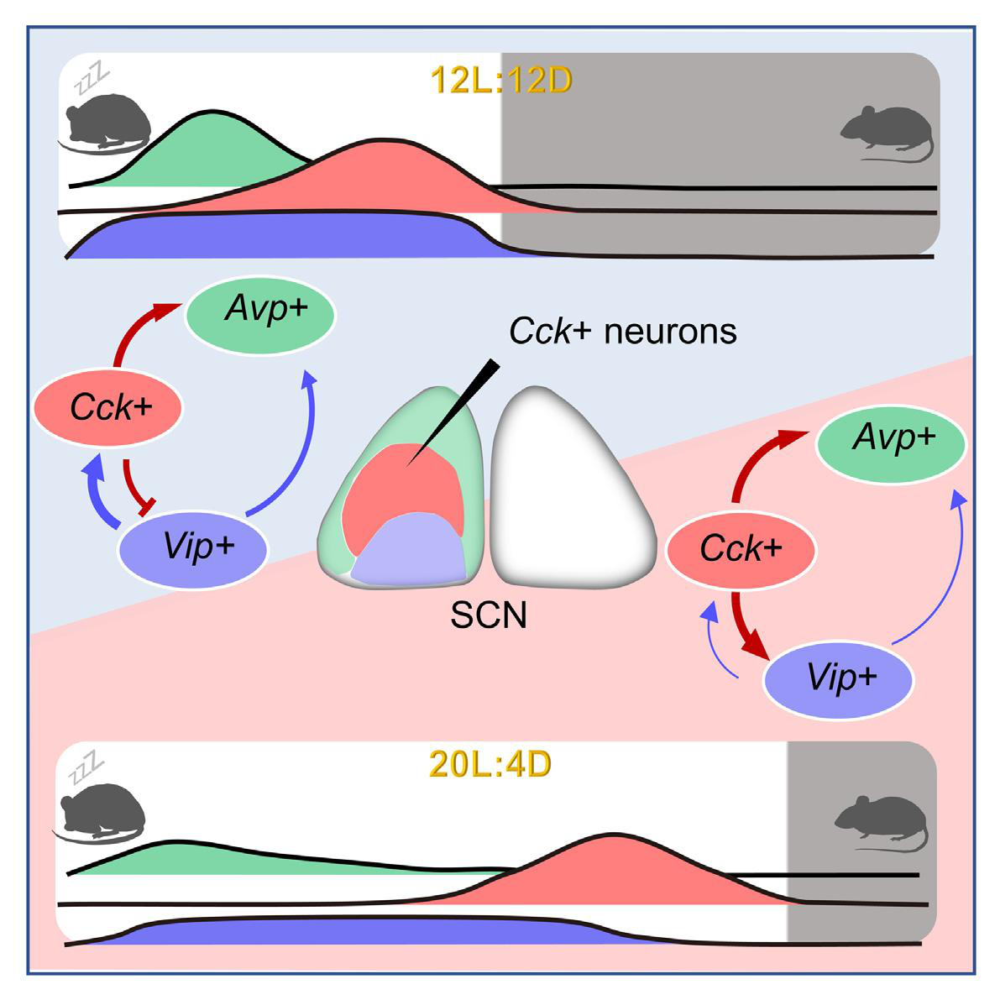

# 小鼠视交叉上核胆囊收缩素神经元调控生物钟稳健性
## Cholecystokinin neurons in mouse suprachiasmatic nucleus regulate the robustness of circadian clock

[](https://doi.org/10.1016/j.neuron.2023.04.026)
[](https://doi.org/10.1016/j.neuron.2023.04.026)
[](https://18297928865.github.io/scn-cck-circadian-clock-translation/)
[](#)

> **本项目专为神经科学与时间生物学博士生 / 青年学者文献汇报（Journal Club / Seminar）及答辩精心打造。**  
> 包含 **100% 忠实原文的全文逐字逐句翻译**（严格保留所有 Figure 引用，插入原篇高清插图与中英双语图注）、**专业概念深度解析**、**学术研讨 6 大核心新颖点提炼**、**Pittendrigh-Daan E/M 假说半世纪演进背景拓展**，以及**导师/评委高频 5 大答辩 Q&A 模拟全套实战解答**。

---

## 🌐 线上交互式论文阅读网页 (Interactive Webpage)

👉 **一键在线访问完整交互式论文网页**：[https://18297928865.github.io/scn-cck-circadian-clock-translation/](https://18297928865.github.io/scn-cck-circadian-clock-translation/)

### 网页核心特性：
- 🌟 **全文字词对照与专业术语释义**：罕见词汇后均附带英文原词标注与概念拓展卡片。
- 🖼️ **原论文全高清图表无缝内嵌**：Graphical Abstract 及 Figure 1 ~ Figure 6 全图插入对应章节，支持点击**模态灯箱（Lightbox）全屏高清单图放大**。
- 🌓 **一键暗黑/明亮模式切换**：支持系统自适应与随时手动切换护眼主题。
- 🌐 **双语灵活对照显示**：支持一键隐藏/展开英文原文对比框。
- 📑 **浮动滚动监听目录（Scrollspy TOC）与阅读进度条**：章节跳转随心所欲。
- 🎓 **文献汇报与答辩专属模块**：系统总结 6 大创新点、重要性、深度背景及 5 大答辩质疑应对策略。

---

## 📌 论文核心信息 (Paper Information)

- **论文标题**：Cholecystokinin neurons in mouse suprachiasmatic nucleus regulate the robustness of circadian clock  
  （中文直译：小鼠视交叉上核胆囊收缩素神经元调控昼夜节律生物钟的稳健性）
- **发表期刊**：*Neuron* (Volume 111, Issue 14, p2201–2217.e5, July 19, 2023)
- **作者团队**：Peng Xie（谢鹏）, Dan-Dan Dong（董丹丹）, Jun-Xiang Wan（万骏祥）, Ze-Ka Chen（陈泽卡）, Yi-Jun Zhao（赵一君）, Jun Yan（严军, 通讯作者）
- **主要完成单位**：中国科学院脑科学与智能技术卓越创新中心（神经科学研究所）/ 神经科学国家重点实验室 / 中国科学院灵长类神经生物学重点实验室 (CEBSIT / ION, CAS)
- **DOI**：[10.1016/j.neuron.2023.04.026](https://doi.org/10.1016/j.neuron.2023.04.026)

---

## 🔬 核心科学发现概览 (Graphical Abstract)



1. **确立 SCN CCK 神经元的晨振荡器/傍晚缓冲器身份**：SCN 前外壳区的 CCK 神经元钙活动峰始终紧贴动物夜间活动起始前（activity onset），在 12L:12D、16L:8D 和持续光照（LL）下展现出极其顽健的节律稳定性。
2. **长光周期下 CCK 与 VIP 的特异性解离**：腹侧 VIP 神经元钙活动变宽并弥散在整个长光照期，而背侧 CCK 神经元维持紧密的单峰聚集。
3. **前移相位对抗光致后移的分子刹车**：长光照在黄昏诱发强烈的相位后移拉扯，而 CCK 神经元激活特异性产生相位前移（phase advance），充当制动刹车，维持节律稳定。
4. **稳健性与可塑性的“双刃剑”平衡**：特异性损毁 CCK 神经元或敲除 CCK 肽虽然降低了光周期适应韧性，却使小鼠在 6 小时模拟时差（Jet lag）中的再夹带恢复速度提升数倍（由 4-5 天显著提速至 1-2 天）。

---

## 📂 仓库目录结构 (Directory Structure)

```text
scn-cck-circadian-clock-translation/
├── index.html               # 交互式网页核心单文件（包含全译文、高清图表、答辩指南）
├── build.py                 # 网页自动化组装与构建脚本
├── README.md                # 仓库详尽介绍文档
├── figures/                 # 论文高清矢量提取图表集合 (1080P+)
│   ├── graphical_abstract.png
│   ├── figure1.png
│   ├── figure2.png
│   ├── figure3.png
│   ├── figure4.png
│   ├── figure5.png
│   └── figure6.png
├── images/                  # 图表镜像备份目录
└── sections/                # 模块化独立翻译与研讨章节源码
    ├── meta.py              # 论文元数据、Graphical Abstract 与 In Brief
    ├── intro.py             # 引言逐字翻译与核心背景拓展
    ├── results_1_2.py       # 结果 1-2 全文翻译、图1-2与图注
    ├── results_3_4.py       # 结果 3-4 全文翻译、图3-4与图注
    ├── results_5_6.py       # 结果 5-6 全文翻译、图5-6与图注
    ├── discussion.py        # 讨论逐字翻译与物种间模型对照
    ├── methods.py           # STAR+Methods 详尽实验方法全译
    └── seminar.py           # 汇报答辩 6大创新点、重要性、深度背景与 5大问答
```

---

## 💻 本地预览与使用方法 (Local Usage)

直接克隆仓库并在任意现代浏览器中打开 `index.html` 即可：

```bash
# 1. 克隆本仓库
git clone https://github.com/18297928865/scn-cck-circadian-clock-translation.git

# 2. 进入项目目录
cd scn-cck-circadian-clock-translation

# 3. 启动本地轻量静态服务器（或双击 index.html 浏览器直接打开）
python -m http.server 8080
```
在浏览器中访问 `http://localhost:8080` 即可享受完整的交互式阅读体验。

---

## 📖 引用信息 (Citation)

If you find this translation and seminar compilation helpful for your literature research or academic seminar, please cite the original article:

```bibtex
@article{xie2023cholecystokinin,
  title={Cholecystokinin neurons in mouse suprachiasmatic nucleus regulate the robustness of circadian clock},
  author={Xie, Peng and Dong, Dan-Dan and Wan, Jun-Xiang and Chen, Ze-Ka and Zhao, Yi-Jun and Yan, Jun},
  journal={Neuron},
  volume={111},
  number={14},
  pages={2201--2217},
  year={2023},
  publisher={Elsevier},
  doi={10.1016/j.neuron.2023.04.026}
}
```
